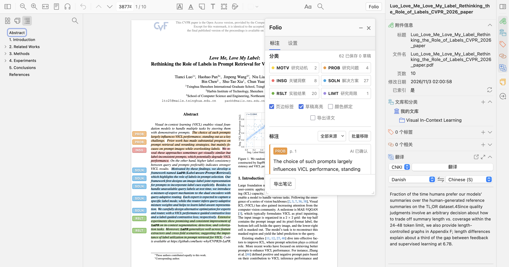
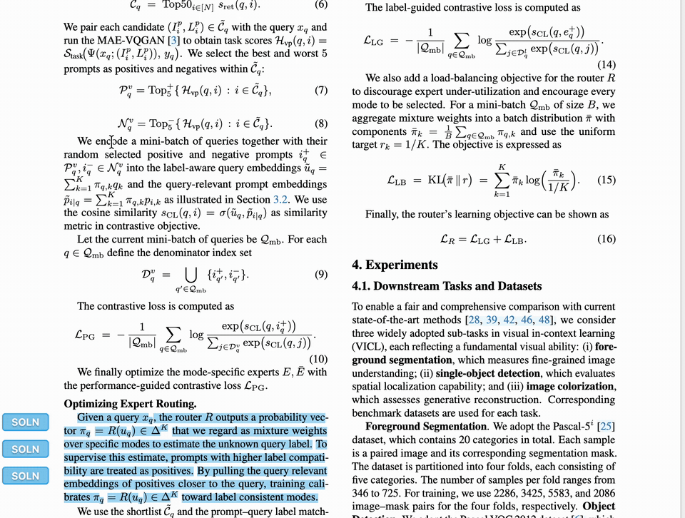
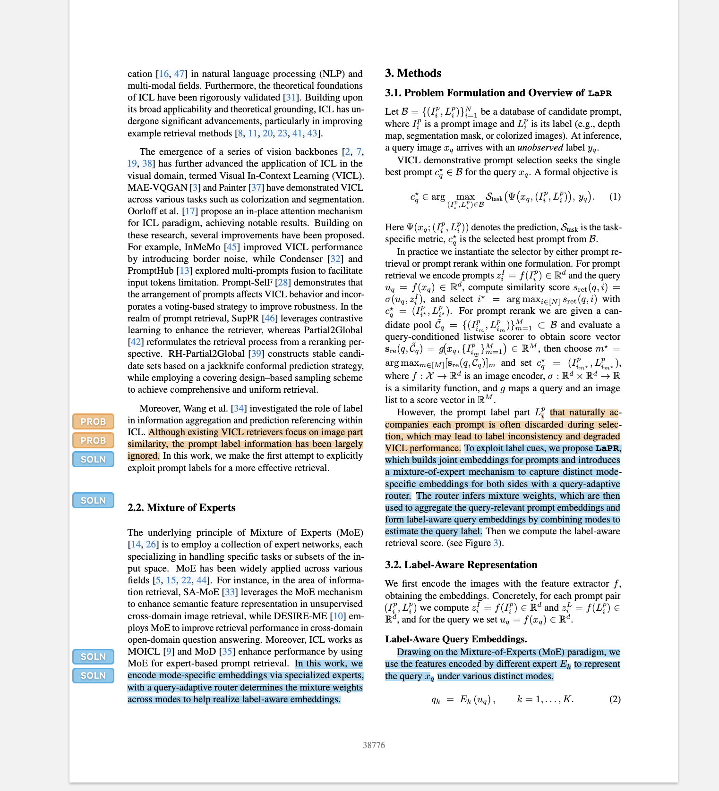
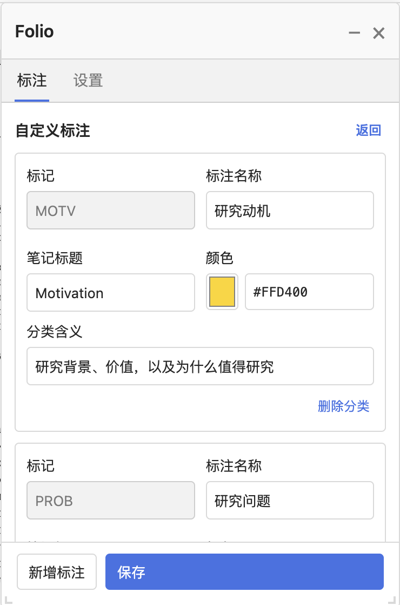
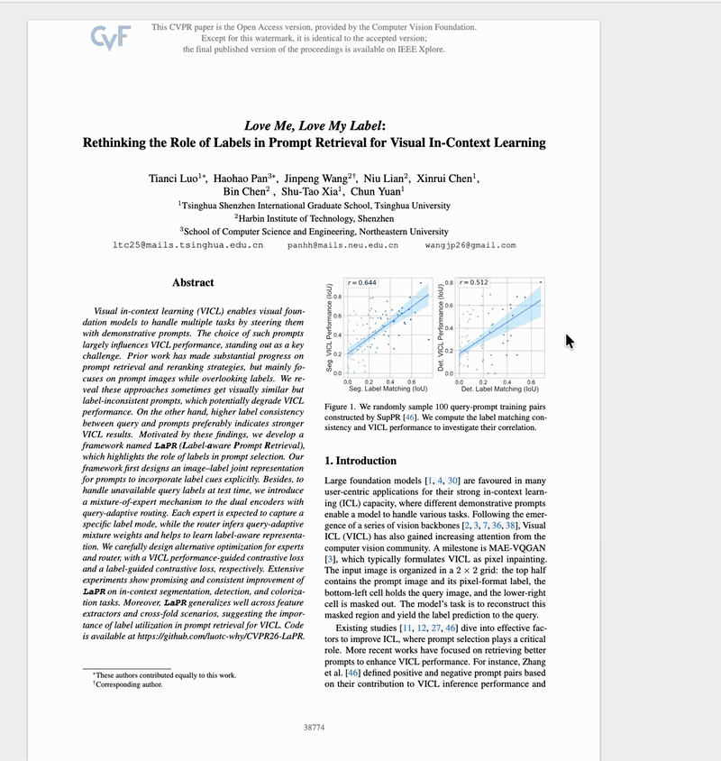
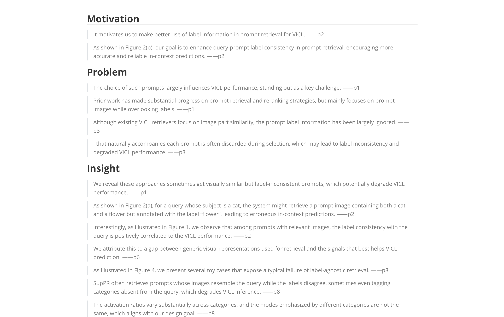
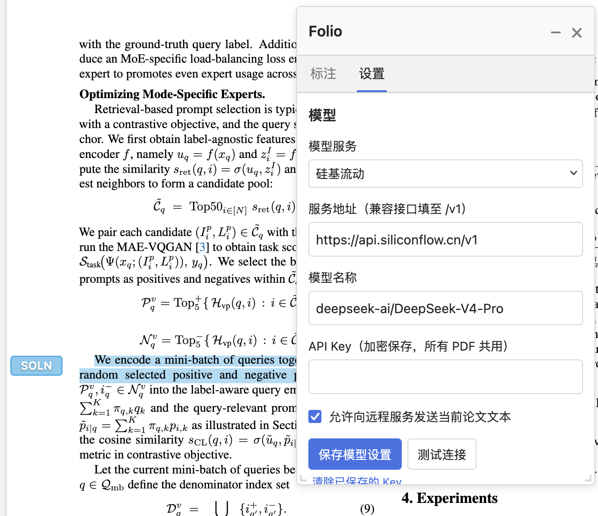

<h1 align="center">Folio：知页</h1>

<p align="center"><a href="README.md">简体中文</a> &nbsp; / &nbsp; <strong>English</strong></p>

<p align="center"><strong>Give your highlights meaning. Turn your reading into structured notes.</strong></p>

<p align="center">
  <a href="https://github.com/panhh0804/folio-zotero/releases"></a>
  
  <a href="LICENSE"></a>
</p>

<p align="center">
  <a href="#see-it-in-action">See it in action</a> &nbsp; / &nbsp;
  <a href="#installation">Installation</a> &nbsp; / &nbsp;
  <a href="#quick-start">Quick start</a> &nbsp; / &nbsp;
  <a href="#model-configuration">Model configuration</a> &nbsp; / &nbsp;
  <a href="#faq">FAQ</a>
</p>

Folio is a semantic annotation plugin for Zotero. Label key passages as motivations, problems, insights, solutions, results, or limitations directly in the PDF reader. Persistent margin labels help you follow the paper's argument, while Markdown export brings together the original text, your comments, and optional translations.

Annotate passages yourself, or let AI suggest important sentences for you to review. Selection, classification, comments, and translation all stay in the reader.



## Why Folio?

| What you need while reading | How Folio helps |
| --- | --- |
| Remember why a highlighted sentence matters | Six semantic categories distinguish background, problems, methods, and conclusions |
| Keep the paper's structure visible as you read | Margin labels remain visible and scale with the PDF page |
| Use AI without giving up your own judgment | Review drafts, change categories, accept or reject suggestions, and save selected results |
| Record your interpretation alongside the evidence | Add automatically saved comments to annotation cards |
| Translate passages when you need to | Share the selection popup with Translate for Zotero, or translate individual cards on demand |
| Reuse your reading notes afterward | Export Markdown grouped by category, with page references, comments, and optional translations |

## See it in action

### Select a passage and identify its role

Select text in Zotero and click a category in the popup. Folio saves a semantic highlight and displays its label in the page margin. Manual annotation requires neither a model nor an API key.



Six categories are provided by default. You can customize their names, colors, and definitions to match your reading workflow.

| Label | Category | What to look for |
| --- | --- | --- |
| 🟡 **MOTV** | Motivation | Why the problem matters and what motivates the research |
| 🟠 **PROB** | Problem | Gaps in existing approaches and unresolved challenges |
| 🔴 **INSG** | Insight | Important observations, patterns, or explanations |
| 🔵 **SOLN** | Solution | The proposed method, mechanism, or system |
| 🟢 **RSLT** | Results | Experimental findings and the evidence supporting them |
| 🟣 **LIMT** | Limitation | Limitations, assumptions, and boundaries of applicability |

<details>
<summary>A closer look at margin labels and custom categories</summary>

Margin labels follow the positions of the original passages and scale with the page. Ordinary colored highlights and semantic categories are separate by default: a highlight becomes a Folio annotation when you explicitly assign a category.

<p align="center"></p>

Edit the category JSON under Settings → Category configuration (`设置 → 分类配置`). You can import or export your configuration and restore the defaults.

<p align="center"></p>

</details>

### Let AI suggest passages, then make the final decision

Choose AI mode (`AI 自动`), select an annotation density—Core (`核心`), Balanced (`均衡`), or Comprehensive (`完整`)—and click Analyze paper (`分析论文`). Folio selects important sentences, classifies them, and creates drafts. Edit, accept, or reject individual suggestions, or save the drafts you have selected.

**Completing an AI analysis does not save its suggestions as final annotations. Review and save the drafts to create native Zotero annotations.**



### Bring your highlights, comments, and translations into your notes

Write a comment in an annotation card. Clicking outside the field ends editing and saves your changes. Click Translate (`翻译`) when you need a translation; the original text and your comments remain separate. Card translation requires an installed and configured copy of [Translate for Zotero](https://github.com/windingwind/zotero-pdf-translate).

Click Export notes (`导出笔记`) to create a Markdown file named `阅读笔记-<paper title>.md`:

- Passages are grouped under Motivation, Problem, Insight, Solution, Results, and Limitation.
- Page references follow the original text, for example `Original passage ——p2`.
- Your comments are exported with their corresponding passages.
- Enable Export translations (`导出译文`) to include all generated translations, or choose translations from specific cards.



Export includes translations that have already been generated. It does not make additional translation requests.

## Installation

Current version: **1.0.10**. The plugin manifest supports **Zotero 10.0.7 and later releases in the 10.0.x series**. Tested on macOS with Zotero 10.0.7; other platforms have not been verified.

1. Download a published `.xpi` from [Releases](https://github.com/panhh0804/folio-zotero/releases). If no release package is available yet, build from source using the instructions below.
2. In Zotero, open **Tools → Plugins**.
3. Click the gear icon, choose **Install Plugin From File**, and select the `.xpi`.
4. Quit and reopen Zotero, open a PDF, and click **Folio** in the reader toolbar.

<details>
<summary>Build the installation package from source</summary>

Requires Node.js 20+ and Python 3. There are no npm dependencies to install.

```sh
git clone https://github.com/panhh0804/folio-zotero.git
cd folio-zotero
npm run verify
```

The installation package is written to `dist/Folio-1.0.10.xpi`. Run `npm run package:source` if you also need a source ZIP.

</details>

## Quick start

The current plugin interface is in Chinese. Key labels below include their original Chinese text so you can find the corresponding controls.

**Manual reading: select → categorize → comment → export.**

1. Open a PDF, click Folio, and choose Manual annotation (`人工标注`).
2. Select a sentence and click a category in the selection popup. You can also classify the current selection from the Selected text (`选中文本`) area of the Folio panel.
3. Add comments in the annotation cards and click Translate (`翻译`) if needed.
4. When you finish reading, choose whether to include translations and click Export notes (`导出笔记`).

**AI assistance: configure → analyze → review → save.**

1. Enter your model service and API key in Settings (`设置`), then test the connection.
2. Switch to AI mode (`AI 自动`), choose an annotation density, and click Analyze paper (`分析论文`).
3. Check the passages and their assigned categories. Edit or reject suggestions as needed.
4. Accept individual drafts or click Save selected drafts (`保存选中草稿`) to save them as native annotations.

Drag or resize the floating panel to fit your workspace, or use the minus button in its title bar to collapse it into a small window. Turning pages or collapsing the panel does not remove existing margin labels.

## Model configuration

Folio does not provide an API key. To use AI analysis, supply your own service address, model ID, and key. The following example uses the SiliconFlow service shown in the demonstration:

| Setting | Example |
| --- | --- |
| Model service | SiliconFlow (`硅基流动`) |
| Service address | `https://api.siliconflow.cn/v1` |
| Model ID | `deepseek-ai/DeepSeek-V4-Pro` |
| API key | Your personal SiliconFlow key |
| Remote processing permission | Enable Allow sending the current paper's text to a remote service (`允许向远程服务发送当前论文文本`) |

Click Save model settings (`保存模型设置`) or Test connection (`测试连接`). The connection test sends a short test prompt without paper content, but may still incur a small API charge.

<details>
<summary>Model configuration screenshot</summary>

<p align="center"></p>

</details>

You can also choose OpenAI-compatible API (`OpenAI 兼容接口`) and enter a Chat Completions-compatible API base URL, model ID, and key. Remote endpoints require HTTPS. Availability, quotas, and pricing depend on the provider.

Keys are encrypted using Zotero's operating-system key storage and stored separately for each service address. They are shared across PDFs on the same computer and loaded after Zotero restarts. Keys are not written to ordinary configuration files or exported notes. Once a key has been saved, leaving the field empty keeps it unchanged; you can also clear the saved key in Settings.

## FAQ

<details>
<summary>Do ordinary highlights automatically become semantic annotations?</summary>

No, not by default. Color binding (`颜色绑定`) is off by default. Highlights made with Zotero's standard color tools remain ordinary highlights. Explicitly choosing a Folio category saves its semantic classification and displays a margin label.

When color binding is enabled, highlights whose colors match a category are displayed with that category. Turning it off removes the color-based mapping without changing the underlying highlights or comments.

</details>

<details>
<summary>What happens when I remove annotations? Can I restore them?</summary>

Remove annotation (`移除标注`) on a card and Bulk remove (`批量移除`) in the list remove Folio annotations together with their native highlights. Bulk removal can target AI annotations, manual annotations, or all Folio annotations in the current PDF. Ordinary highlights that have not been assigned to Folio are left alone, even if their colors match.

Click Restore (`恢复`) beside the removal message, or choose Restore last removal (`恢复上次移除`) in the menu. Folio keeps the most recent removal record for each PDF, including original text, coordinates, colors, comments, tags, and drafts. The record remains available after a restart.

If you explicitly assign a Folio category to an existing ordinary highlight, it becomes a Folio annotation and is included in these removal operations.

</details>

<details>
<summary>Will updating the plugin erase my annotations?</summary>

From version 1.0.0 onward, Folio retains its plugin ID and record formats. Updating the plugin while using the same Zotero library and profile preserves native highlights, categories, comments, and local drafts. You do not need to annotate the paper again.

</details>

<details>
<summary>Where are paper content and API keys stored?</summary>

Final annotations are stored in your Zotero library and can sync with Zotero's native annotations. Drafts and the latest removal record are stored in local preferences. Folio does not modify the original PDF or create a separate cloud document library.

AI analysis sends relevant paper text to your configured remote service only after you enable that permission. Translate for Zotero uses its configured translation service. API keys are encrypted using Zotero's operating-system key storage. Card translations remain in the current reading session only.

</details>

<details>
<summary>What are the current limitations?</summary>

- Scanned PDFs require OCR first.
- Complex equations, cross-page passages, and some two-column layouts may affect extraction or positioning. AI categories need human review.
- Margin labels currently share the left side of the page. Closely spaced labels are stacked to avoid overlap.
- Export currently supports Markdown. Writing margin labels into the PDF and analyzing an entire library in one batch are not supported.
- Updates currently require manual installation; there is no online automatic update service.

</details>

## Feedback

Questions and suggestions are welcome through [Issues](https://github.com/panhh0804/folio-zotero/issues). Include your Zotero version, Folio version, operating system, reproduction steps, and any useful screenshots. Do not include API keys or private library files.

## Special thanks

**Special thanks to [Keylight](https://keylight.pacificstudio.ai) for inspiring Folio.**

Thanks to [Zotero](https://www.zotero.org/) for its reader and native annotation capabilities, and to [Translate for Zotero](https://github.com/windingwind/zotero-pdf-translate) for its translation API.

## License

Folio is licensed under the **[Apache License 2.0](LICENSE)**. See [NOTICE](NOTICE) for copyright and third-party display notices.

Copyright © 2026 **Haohao Pan**.
