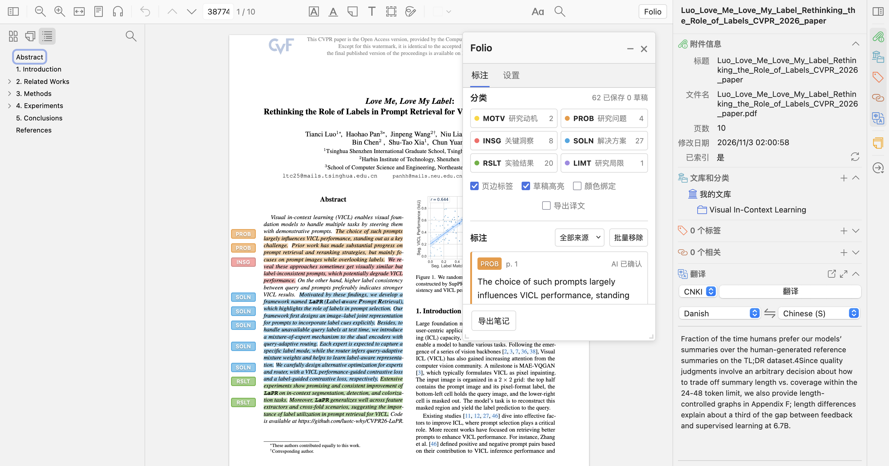
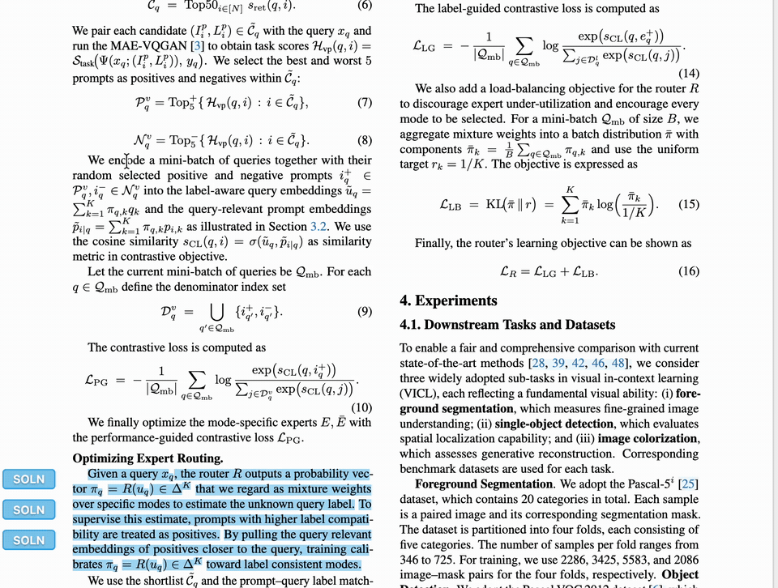
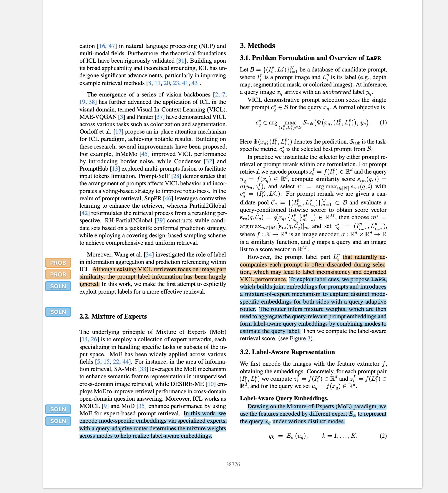
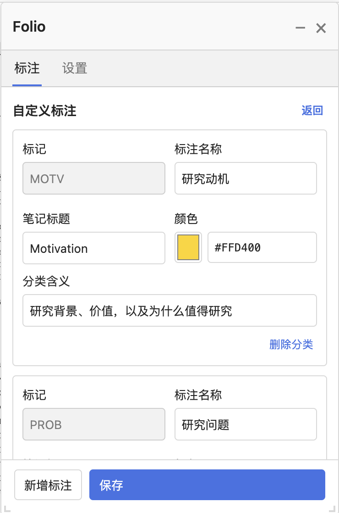
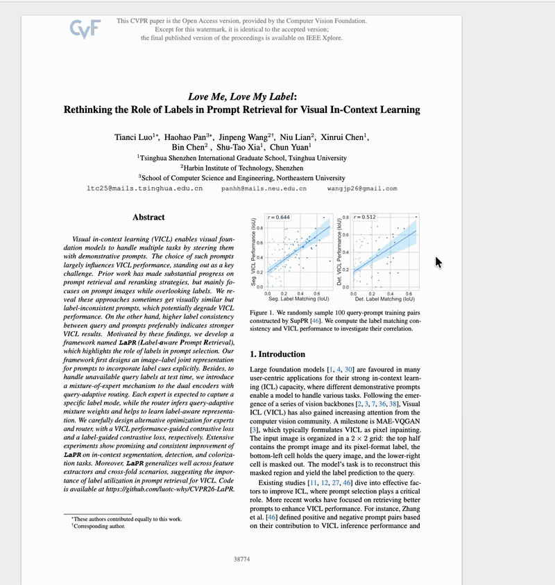
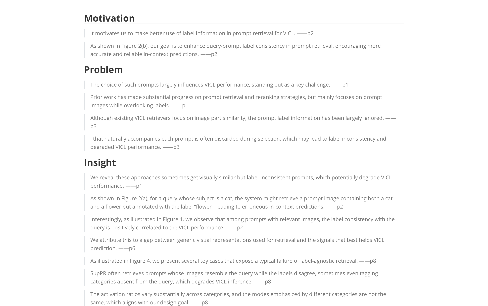
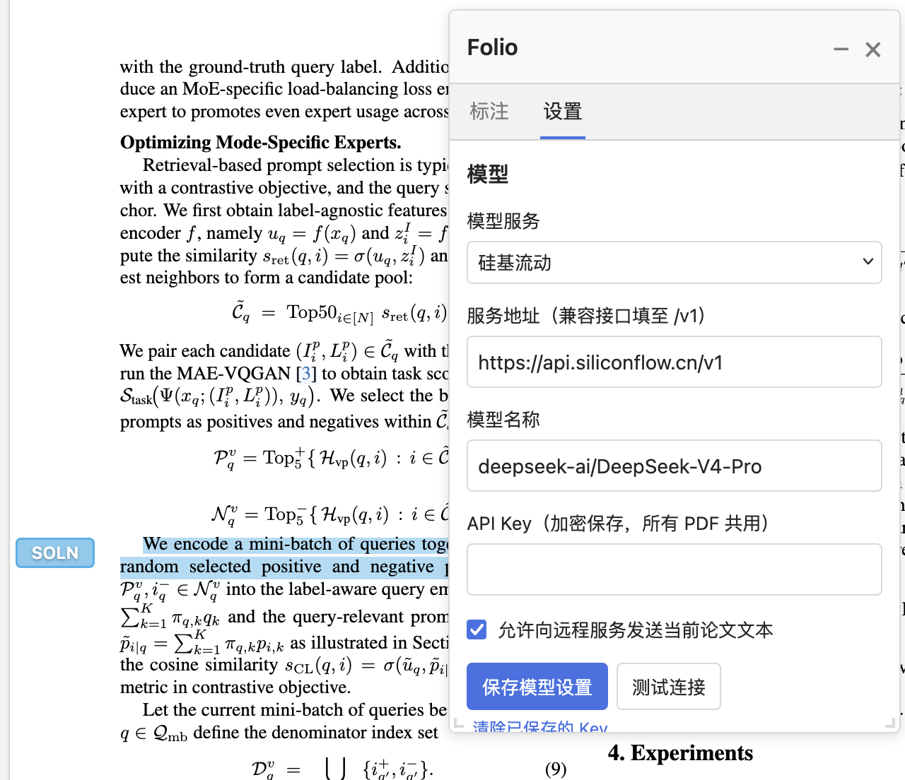

<h1 align="center">Folio：知页</h1>

<p align="center"><strong>简体中文</strong> &nbsp; / &nbsp; <a href="README.en.md">English</a></p>

<p align="center"><strong>给论文高亮加上语义，把阅读整理成笔记。</strong></p>

<p align="center">
  <a href="https://github.com/panhh0804/folio-zotero/releases"></a>
  
  <a href="LICENSE"></a>
</p>

<p align="center">
  <a href="#功能演示">功能演示</a> &nbsp; / &nbsp;
  <a href="#安装">安装</a> &nbsp; / &nbsp;
  <a href="#快速上手">快速上手</a> &nbsp; / &nbsp;
  <a href="#模型配置">模型配置</a> &nbsp; / &nbsp;
  <a href="#常见问题">常见问题</a>
</p>

Folio 是一款 Zotero 语义标注插件。在 PDF 阅读器中，为关键句标记研究动机、问题、洞察、方案、结果与局限，用持续显示的页边标签梳理论文结构，再将原文、评论和译文整理为 Markdown 阅读笔记。

你可以自己判断每一句的作用，也可以先让 AI 筛选全文，再逐条审核。选句、分类、评论和翻译都在同一个阅读器中完成。



## 为什么使用 Folio

| 阅读中的需要 | Folio 的做法 |
| --- | --- |
| 记得划过，却忘了这句话为什么重要 | 用六类语义标记区分背景、问题、方法与结论 |
| 翻页或切换高亮后，还想看到文章结构 | 页边标签持续显示，并随 PDF 页面缩放 |
| 想让 AI 帮忙，但仍要自己判断 | AI 先生成草稿，支持改分类、接受、拒绝和批量保存 |
| 阅读时顺手记下自己的理解 | 在标注卡片中添加评论，自动保存 |
| 阅读英文时需要翻译 | 与 Translate for Zotero 共用选词弹窗，也可在卡片内按需翻译 |
| 读完后需要一份能复用的笔记 | 按语义分类导出 Markdown，保留页码、评论和可选译文 |

## 功能演示

### 选一句，标明它在论文中的作用

在 Zotero 中选中文字，点击弹窗中的分类按钮，即可保存语义高亮，并在页边显示对应标签。人工标注无需配置模型，也不需要 API Key。



默认提供六类标签，也可以按自己的阅读方法调整名称、颜色和分类定义。

| 标签 | 语义 | 关注什么 |
| --- | --- | --- |
| 🟡 **MOTV** | Motivation / 研究动机 | 为什么研究这个问题，它有什么价值 |
| 🟠 **PROB** | Problem / 研究问题 | 现有方法有什么不足，挑战是什么 |
| 🔴 **INSG** | Insight / 关键洞察 | 有哪些重要观察、规律或解释 |
| 🔵 **SOLN** | Solution / 解决方案 | 作者提出了什么方法、机制或系统 |
| 🟢 **RSLT** | Results / 实验结果 | 实验说明了什么，证据是否充分 |
| 🟣 **LIMT** | Limitation / 研究局限 | 有哪些限制，适用于什么边界 |

<details>
<summary>查看页边标签近景与分类配置</summary>

页边标签与原文位置关联，随页面缩放。普通颜色高亮与语义分类默认分开；只有明确选择分类，才成为 Folio 标注。

<p align="center"></p>

在「设置 → 分类配置」中编辑分类 JSON，支持导入、导出和恢复默认配置。

<p align="center"></p>

</details>

### 让 AI 先筛选，再由你确认

选择「AI 自动」，设置标注密度，点击「分析论文」。核心保留中心问题、主要贡献与决定性结论；均衡覆盖主要论证、关键方法和代表性证据；完整进一步保留重要细节、消融、泛化与适用边界。三档的标注数量上限分别约为可提取句子的 6%、12%、22%（向上取整），仅作为上限，不为凑数添加标注，也不强制补齐分类。Folio 会筛选关键句、分类并生成草稿；你可以逐条修改、接受或拒绝，也可以保存勾选的草稿。

**AI 分析完成不等于正式保存。审核后的结果，才会成为 Zotero 原生标注。**



### 把高亮、评论和译文带进阅读笔记

在卡片内记录想法，点击框外退出编辑并保存。需要翻译时点击「翻译」，原文和评论会分别保留。卡片翻译依赖已安装并配置好的 [Translate for Zotero](https://github.com/windingwind/zotero-pdf-translate)。

点击「导出笔记」，生成 `阅读笔记-论文标题.md`：

- 按 Motivation、Problem、Insight、Solution、Results、Limitation 分组。
- 原文后附页码，格式为 `原文 ——p2`。
- 评论随对应原文导出。
- 勾选「导出译文」后，可导出全部已生成译文，或只附上指定卡片的译文。



导出的是已经生成的译文，不会在导出时额外发起翻译请求。

## 安装

当前版本 **1.0.11**，支持清单范围为 **Zotero 10.0.7 及以上的 10.0.x 版本**。已测试环境为 macOS / Zotero 10.0.7；其他平台尚未验证。

1. 从 [Releases](https://github.com/panhh0804/folio-zotero/releases) 获取已发布的 `.xpi` 安装包。若尚未提供发布包，可按下方步骤从源码构建。
2. 在 Zotero 中打开「工具 → 插件」。
3. 点击齿轮，选择「从文件安装插件」，选中 `.xpi`。
4. 安装后完整退出并重新打开 Zotero，在 PDF 阅读器工具栏点击 **Folio**。

<details>
<summary>从源码构建安装包</summary>

需要 Node.js 20+、Python 3；项目没有需要安装的 npm 依赖。

```sh
git clone https://github.com/panhh0804/folio-zotero.git
cd folio-zotero
npm run verify
```

安装包位于 `dist/Folio-1.0.11.xpi`。如需源码 ZIP，运行 `npm run package:source`。

</details>

## 快速上手

**人工阅读：选句 → 分类 → 评论 → 导出。**

1. 打开 PDF，点击 Folio，选择「人工标注」。
2. 在正文中选中一句话，点击选词弹窗中的分类按钮。也可以使用 Folio 面板的「选中文本」区域进行分类。
3. 在卡片中补充评论；如有需要，点击「翻译」。
4. 阅读结束后，选择译文导出范围，点击「导出笔记」。

**AI 辅助：配置模型 → 分析 → 审核 → 保存。**

1. 在「设置」中填写自己的模型服务和 API Key，并测试连接。
2. 切换到「AI 自动」，选择标注密度，点击「分析论文」。
3. 检查草稿的原文位置和分类，修改或拒绝不合适的结果。
4. 接受草稿或点击「保存选中草稿」，将确认后的内容保存为原生标注。

浮动面板可拖动、调整大小，也可点击标题栏的减号收起为小窗。翻页或收起面板不会移除已经显示的页边标签。

## 模型配置

Folio 不提供 API Key。使用 AI 分析时，需要填写你自己的服务地址、模型名称和 Key。下面以演示中使用的硅基流动配置为例：

| 设置项 | 示例 |
| --- | --- |
| 模型服务 | 硅基流动 |
| 服务地址 | `https://api.siliconflow.cn/v1` |
| 模型名称 | `deepseek-ai/DeepSeek-V4-Pro` |
| API Key | 在硅基流动获取的个人 Key |
| 远程发送授权 | 勾选「允许向远程服务发送当前论文文本」 |

填写后点击「保存模型设置」，或使用「测试连接」检查配置。测试连接仅发送简短测试内容，不包含论文，但仍可能产生少量服务调用费用。

<details>
<summary>查看模型配置界面</summary>

<p align="center"></p>

</details>

也可选择「OpenAI 兼容接口」，填写兼容 Chat Completions 的 API 根地址、模型 ID 和 Key。远程地址需要 HTTPS；是否可用、额度与费用由相应服务决定。

Key 使用 Zotero 的系统密钥存储加密，按服务地址分别保存。本机不同 PDF 共享，重启 Zotero 后自动读取；Key 不会写进普通配置或阅读笔记。填写一次后，留空保存会保留原 Key，也可在设置中清除。

## 常见问题

<details>
<summary>普通高亮会自动变成分类吗？</summary>

默认不会。「颜色绑定」默认关闭：使用 Zotero 原生颜色工具创建的高亮仍是普通高亮。明确选择 Folio 分类后，才会保存分类并显示页边标签。

开启颜色绑定后，匹配颜色的高亮会显示对应分类；关闭后移除这些颜色映射，不改写原高亮或评论。

</details>

<details>
<summary>移除标注会删除什么？可以恢复吗？</summary>

卡片中的「移除标注」和列表中的「批量移除」会一并删除 Folio 标注及对应高亮。批量操作可选择 AI、人工或全部 Folio 标注，只作用于当前 PDF；未加入 Folio 的普通高亮不处理，即使颜色相同。

移除后的提示旁可点击「恢复」，菜单中也提供「恢复上次移除」。每篇 PDF 保留最近一次记录，完整保存对应高亮的原文、坐标、颜色、评论、标签和草稿，重启后仍可恢复。

已有普通高亮如果通过明确选择分类加入 Folio，此后会按 Folio 标注管理，也在移除范围内。

</details>

<details>
<summary>更新后会丢失标注吗？</summary>

从 1.0.0 开始，后续版本沿用同一个插件 ID 和记录格式。使用相同 Zotero 文献库和配置目录，直接更新插件即可继承原生高亮、分类、评论与本机草稿，不需要重新标注。

</details>

<details>
<summary>论文内容和 Key 会保存在哪里？</summary>

正式标注保存在 Zotero 文献库中，可随 Zotero 原生批注同步；草稿和最近一次移除的恢复记录保存在本机偏好中。Folio 不修改原始 PDF，也不建立额外的云端文献库。

AI 分析只在你授权远程发送后，才会把相关论文文本交给所配置的服务。翻译由 Translate for Zotero 调用其当前配置的服务。Key 使用 Zotero 系统密钥存储加密，卡片译文仅保留在当前阅读会话中。

</details>

<details>
<summary>有哪些使用边界？</summary>

- 扫描版 PDF 需要先完成 OCR。
- 复杂公式、跨页段落和部分双栏排版可能影响文本提取与定位；AI 分类需要人工审核。
- 当前页边标签统一位于页面左侧；密集标签会错开排列。
- 当前导出格式为 Markdown，尚不支持把页边标签写入 PDF，也没有文献库批量分析。
- 当前通过手动安装更新，没有在线自动更新服务。

</details>

## 反馈与建议

欢迎通过 [Issues](https://github.com/panhh0804/folio-zotero/issues) 反馈问题或建议。请附上 Zotero 版本、Folio 版本、操作系统、复现步骤和必要截图，不要提交 API Key 或私人文献库文件。

## 特别致谢

**特别感谢 [Keylight](https://keylight.pacificstudio.ai) 为 Folio 提供灵感。**

感谢 [Zotero](https://www.zotero.org/) 提供阅读器与原生批注能力，感谢 [Translate for Zotero](https://github.com/windingwind/zotero-pdf-translate) 提供翻译接口。

## 许可证

Folio 采用 **[Apache License 2.0](LICENSE)**，版权与第三方展示内容说明见 [NOTICE](NOTICE)。

Copyright © 2026 **Haohao Pan**.
